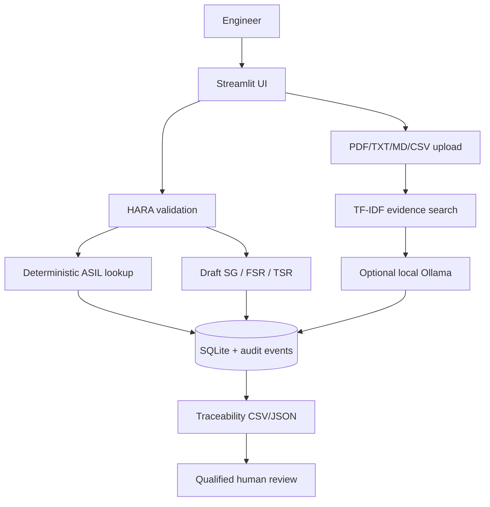

# AI-Assisted HARA and Functional Safety Requirement Management Assistant

**Student:** Bhuvaneshwari D | **Register No.:** 227003030 | **SASTRA Deemed University**

This is a full educational capstone prototype: Streamlit HARA workflow, deterministic candidate ASIL lookup, draft Safety Goals/FSRs/TSRs, document evidence search, SQLite persistence, audit events, CSV/JSON export, tests, Docker, report/declaration templates, and documentation.

> **Safety disclaimer:** This is not a certified ISO 26262 tool and does not establish compliance. Every candidate ASIL and safety artifact requires review by a qualified functional-safety professional against the applicable licensed standard and approved organizational process. Do not use this prototype as the sole basis for a vehicle safety decision.

## ASIL source and limitation
The matrix is based on public secondary explanations, not a reproduction of the normative standard:
- Spilma, “ISO 26262: automotive functional safety, 12 parts,” section ASIL determination: https://www.spilma.com/en/guides/iso-26262-automotive-functional-safety
- Cross-check: Kirra Systems HARA guide: https://github.com/kirra-systems/kirra-runtime-sdk/blob/main/docs/safety/HARA.md
- ISO 26262 series: https://www.iso.org/publication/PUB200262.html

This prototype uses a simplified S1–S3 / E1–E4 / C1–C3 matrix. Public secondary references may differ in editions, interpretation, footnotes, and special cases. Verify the full matrix against the applicable licensed standard and your organization's approved criteria before use. S0/E0/C0 are rejected as unsupported. Outputs are labeled **candidate ASIL**.

| S/E | C1 | C2 | C3 |
|---|---|---|---|
| S1/E1 | QM | QM | QM |
| S1/E2 | QM | QM | QM |
| S1/E3 | QM | QM | ASIL A |
| S1/E4 | QM | ASIL A | ASIL B |
| S2/E1 | QM | QM | QM |
| S2/E2 | QM | QM | ASIL A |
| S2/E3 | QM | ASIL A | ASIL B |
| S2/E4 | ASIL A | ASIL B | ASIL C |
| S3/E1 | QM | QM | ASIL A |
| S3/E2 | QM | ASIL A | ASIL B |
| S3/E3 | ASIL A | ASIL B | ASIL C |
| S3/E4 | ASIL B | ASIL C | ASIL D |

QM is a quality-management classification, not an ASIL; it does not eliminate other quality, reliability, legal, or safety obligations.

## Architecture


## Run with Docker (recommended)
Install/start Docker Desktop. In PowerShell, from the extracted folder:
```powershell
docker compose up --build
```
Open http://localhost:8501. Stop with `docker compose down`.

The app works without Ollama. Optional local model: install Ollama on the host, run `ollama pull phi`, then:
```powershell
$env:OLLAMA_BASE_URL = "http://host.docker.internal:11434"
$env:OLLAMA_MODEL = "phi"
docker compose up --build
```
Use the exact installed model name from `ollama list`.

## Run with Python 3.11
```powershell
py -3.11 -m venv .venv
.\.venv\Scripts\Activate.ps1
python -m pip install --upgrade pip
pip install -r requirements.txt
streamlit run app.py
```
If Python 3.11 is unavailable, use Docker or install it. Check `python --version` and `python -c "import sys; print(sys.executable)"`.

## Workflow
1. New HARA: complete item, malfunction, operational situation, event, harm, S/E/C and rationale.
2. Calculate candidate ASIL and save. Unsupported classes are rejected.
3. Inspect draft Safety Goal, FSR, TSR; these are unapproved templates.
4. Upload permitted project knowledge under Knowledge Base; scanned PDFs require external OCR.
5. Search evidence snippets and review their source filename/page.
6. Export traceability CSV/JSON and record review status.

## Tests
```powershell
pytest -q
```
Tests verify representative matrix cells and input rejection. They do not establish ISO compliance or validate every possible vehicle context.

## Environment
- `HARA_DB_PATH` defaults to `data/hara.db`
- `OLLAMA_BASE_URL` defaults to `http://localhost:11434`
- `OLLAMA_MODEL` defaults to `phi`
- `OLLAMA_TIMEOUT_SECONDS` defaults to `60`

## Project layout
`app.py`, `hara/` (ASIL, requirements, storage, retrieval, optional LLM), `tests/`, `data/`, `Model_Prompts_Config/`, `Input_Data/`, `Synopsis/`, `Code/`, `Evaluation_Results/`, `Documentation/`, `Video/`, `Declarations/`.

## Limitations
No OCR; PDF tables/diagrams may not extract correctly; retrieval is TF-IDF lexical search rather than validated semantic embeddings; optional Ollama may be unavailable; matrix does not cover every normative footnote/special case; no authentication or production hardening. No evaluation results, signatures, or human verification are fabricated in this ZIP.
